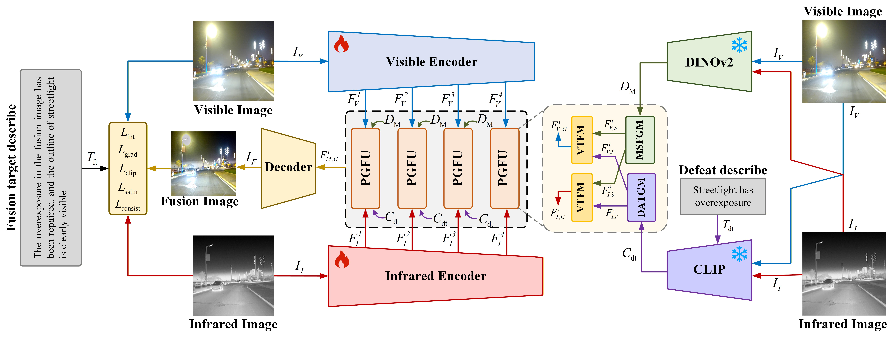
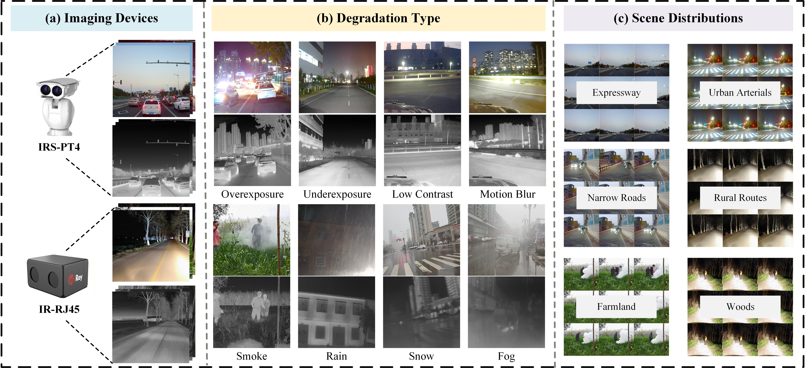

# SGDAFusion: Semantic Prior Guided Degradation-Aware Network for Infrared-Visible Image Fusion

**Information Fusion**  
Guanghui Yue, Zhirong Yao, Cheng Zhao, Weiqing Yan, Bin Jiang, Tianwei Zhou*

[**Paper**](https://www.sciencedirect.com/science/article/pii/S1566253526006871)

---

<div align="center">
  
  <p align="center">
    <em>Fig. 1: Overall architecture of SGDAFusion.</em>
  </p>
</div>

---

## 1. Create Environment

### Create Conda Environment

```bash
conda create -n SGDAFusion python=3.10.13
conda activate SGDAFusion
```

### Install Dependencies

```bash
pip install -r requirements.yml
```

## 2. Prepare Your Dataset

<div align="center">
  
  <p align="center">
    <em>Fig. 2: Overview of the DA-IVIF dataset.</em>
  </p>
</div>

You can also organize your own dataset according to the following directory structure:

```text
dataset/
└── your_dataset/
    ├── train/
    │   ├── vis/
    │   └── ir/
    ├── eval/
    │   ├── vis/
    │   └── ir/
    ├── train.csv
    └── test.csv
```

## 3. Training

To train the model, run:

```bash
python train.py --gpu 1 --config training.yml
```

### Pretrained Weights

To train SGDAFusion with DINOv2 and CLIP, download the corresponding pretrained weights from the following sources:

- **DINOv2:** [Official GitHub Repository](https://github.com/facebookresearch/dinov2)
- **CLIP:** [Jina CLIP Models on Hugging Face](https://huggingface.co/jinaai/clip-models/tree/main)

Please organize the downloaded weights as follows:

```text
SGDAFusion/
├── ViT-B-32.pt
├── dinov2/
│   └── dinov2_vitb14_reg4_pretrain.pth
├── models/
│   └── ...
└── ...
```

## 4. Testing

Run the following command to test the model:

```bash
python test.py
```

## 5. Dataset and Checkpoints

### DA-IVIF Dataset

- **Google Drive:** [Coming Soon](#)
- **Baidu Netdisk:** [Download DA-IVIF](https://pan.baidu.com/s/15m9PJEejmfeukk-oYnx42w?pwd=DA26)  
  Extraction code: `DA26`

### Pretrained Checkpoints

- **Google Drive:** [Coming Soon](#)
- **Baidu Netdisk:** [Download Checkpoints](https://pan.baidu.com/s/19afZlgi0n4hTfOD2GcFtAw?pwd=SGDA)  
  Extraction code: `SGDA`

The Google Drive links will be provided soon.

## 6. Evaluation Metrics

To ensure a fair and unified benchmark, we use a PyTorch-based evaluation toolkit to evaluate all comparison methods.

We sincerely thank the authors for open-sourcing the evaluation code:

- [PyTorch-based Image Fusion Evaluation Metrics](https://github.com/Topanxal/Image-fusion-evaluation-metrics-code-PyTorch-version-)

## 7. Citation

If you find our work or dataset useful for your research, please cite our paper:

```bibtex
@article{YUE2027104811,
  title = {Semantic prior guided degradation-aware network for infrared-visible image fusion},
  journal = {Information Fusion},
  volume = {139},
  pages = {104811},
  year = {2027},
  issn = {1566-2535},
  doi = {https://doi.org/10.1016/j.inffus.2026.104811},
  url = {https://www.sciencedirect.com/science/article/pii/S1566253526006871},
  author = {Guanghui Yue and Zhirong Yao and Cheng Zhao and Weiqing Yan and Bin Jiang and Tianwei Zhou},
  keywords = {Infrared-visible image fusion, Degradation-aware fusion, Semantic prior, Cross-modal alignment}
}
```

